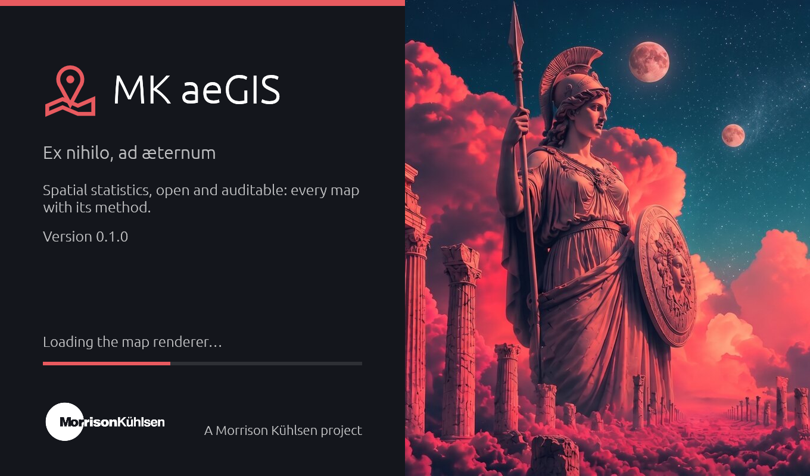
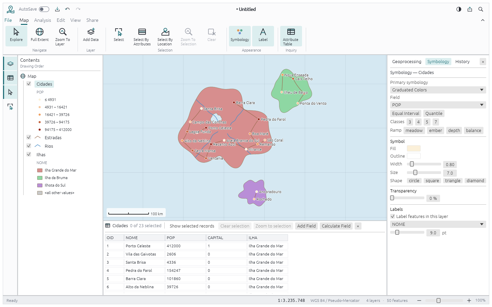
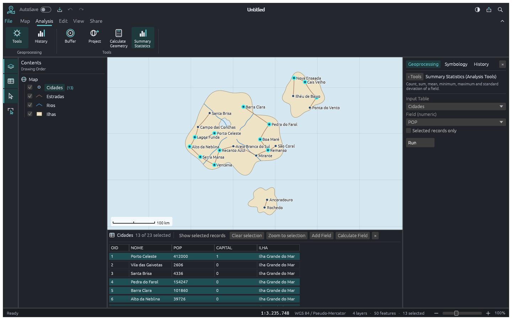
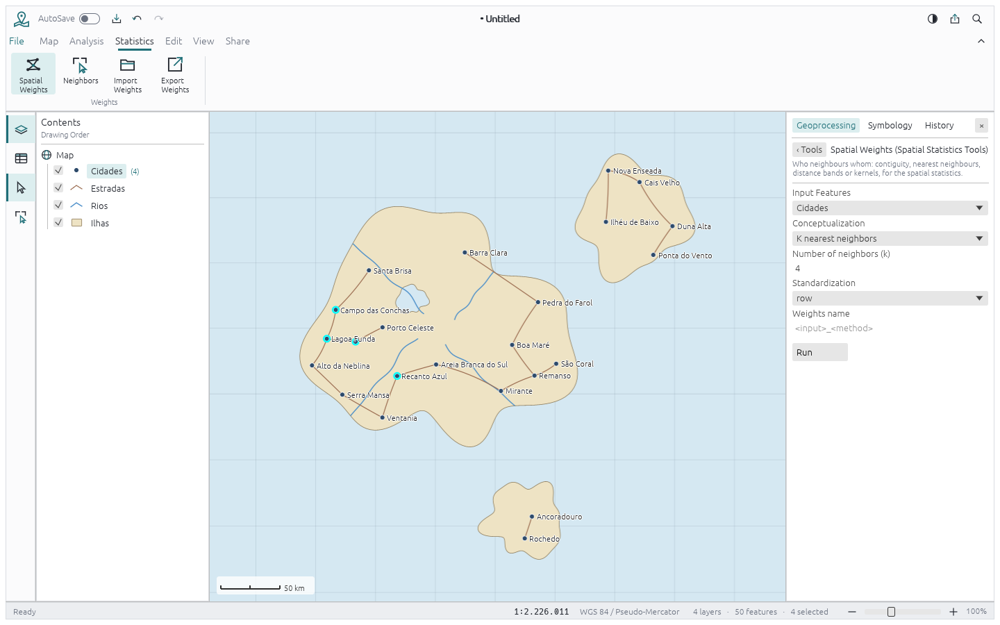

<h1 align="center">MK aeGIS</h1>

<p align="center">
  <b>A statistical GIS: an open-source geographic information system built for statisticians, in pure Rust.</b>
</p>

<p align="center">
  Spatial statistics first (spatial weights, autocorrelation, hot spots, spatial regression,
  point patterns, geostatistics), on top of a fast, clean-room desktop GIS. It runs natively
  on Linux, Windows and macOS, and in the browser via WebAssembly.
</p>

<p align="center">
  <a href="https://github.com/morrisonkuhlsen/aegis/actions/workflows/ci.yml"></a>
  
  
  
  
  <br>
  
  
  
  
  
</p>

<br>

<p align="center">
  
  <br><sub><b>The splash screen</b>, shown while the program loads.</sub>
</p>

<p align="center">
  <a href="#a-look-around">A look around</a> ·
  <a href="#why-mk-aegis">Why MK aeGIS</a> ·
  <a href="#statistics-roadmap">Statistics roadmap</a> ·
  <a href="#quick-start">Quick start</a> ·
  <a href="#for-agents-mcp-cli-and-the-control-channel">For agents</a> ·
  <a href="#architecture">Architecture</a> ·
  <a href="#license-and-credits">License and credits</a>
</p>

## A look around

<table>
<tr>
<td width="50%" valign="top"><p align="center"><sub><b>Classification and symbology.</b> Graduated colours by quantile or equal interval, unique values, labels and the attribute table.</sub></p></td>
<td width="50%" valign="top"><p align="center"><sub><b>Dark mode and analysis.</b> Select By Attributes in SQL, linked selection between map and table, Summary Statistics.</sub></p></td>
</tr>
<tr>
<td width="50%" valign="top"><p align="center"><sub><b>Spatial weights.</b> Contiguity, k nearest neighbours, distance bands and kernels; select a feature's neighbours on the map; GAL/GWT in and out.</sub></p></td>
<td width="50%" valign="top"></td>
</tr>
</table>

## Why MK aeGIS

- **Built for statisticians.** Most GIS packages treat statistics as an add-on. In MK aeGIS
  spatial statistics are the point: every statistic reports what you need to judge it
  (inference method, permutations, p-values, multiple-testing correction), and every result
  is written back as fields you can map, chart and export.
- **Correct by construction.** Every projection, measure and statistic lands with tests against
  independently computed values: published reference values, hand calculation, numerical
  integration. Geodesic distances use Vincenty's formula on the datum's ellipsoid. UTM is held
  to within 1 mm of the integrated meridian arc.
- **Clean-room and open.** File formats and math come from public specifications (the
  Shapefile technical description, GeoJSON RFC 7946, OGC Simple Features, EPSG). Statistics come
  from the published literature, never from GPL code. Licensed MIT OR Apache-2.0.
- **Agent-native.** Every ribbon button, dialog and shortcut is a command. Agents can run it
  over a JSON control channel, an **MCP server**, or the CLI, and so can scripts. That also makes
  analyses reproducible.
- **Never crash.** No panics and no `unsafe` in non-test code. Hostile input (truncated
  shapefiles, NaN coordinates, absurd parameters) returns an error and never brings the app down.
  Closing with unsaved changes asks first.

## Statistics roadmap

Tracked as GitHub issues labelled `statistics`:

| Area                     | What                                                                   | Issue |
|--------------------------|------------------------------------------------------------------------|-------|
| Spatial weights ✓        | Contiguity (queen/rook, order k), k-NN, distance band, kernel; GAL/GWT | #22   |
| Global autocorrelation   | Moran's I, Geary's C, General G, permutation inference                 | #23   |
| Local statistics         | LISA cluster maps, Getis-Ord Gi* hot spots, FDR/Bonferroni             | #24   |
| Linked exploratory views | Histogram, box plot, scatter, Moran scatter plot, brushing to the map  | #25   |
| Classification           | Natural breaks, standard deviation, box map, percentile map, GVF       | #26   |
| Tabular data             | CSV import with types, join by key with a join report                  | #27   |
| Descriptive statistics   | Many fields, group by, weights, quantiles, crosstabs, correlation      | #28   |
| Rates                    | Excess risk, Empirical Bayes and spatial EB smoothing, standardisation | #29   |
| Spatial regression       | OLS with LM diagnostics, spatial lag and error models                  | #30   |
| Point patterns           | Kernel density, nearest neighbour, Ripley's K/L, centrography          | #31   |
| Reproducibility          | History as a script, recorded seeds, analysis report                   | #32   |
| GWR                      | Geographically weighted regression, AICc/CV bandwidth                  | #33   |
| Geostatistics            | IDW, variogram fitting, ordinary/universal kriging, cross-validation   | #34   |

## Downloads

Builds for Linux, Windows and macOS are on the
[Releases](https://github.com/morrisonkuhlsen/aegis/releases) page
([latest](https://github.com/morrisonkuhlsen/aegis/releases/latest)). `<ver>` in the file names is
the version, and `SHA256SUMS.txt` has a checksum for every file. Each archive holds the desktop app
`aegis` and the command line `aegis-cli` (`aegis-cli mcp` is the MCP server).

| System                                 | File                                 | Needs               |
|----------------------------------------|--------------------------------------|---------------------|
| Windows 10 or 11, x64                  | `aegis-<ver>-windows-x64.zip`        | nothing else        |
| macOS 11 or later, Apple silicon/Intel | `aegis-<ver>-macos-universal.tar.gz` | nothing else        |
| Linux x86_64                           | `aegis-<ver>-linux-x86_64.tar.gz`    | glibc 2.39 or later |

The builds aren't code-signed yet, so the first launch asks for confirmation:

- **Windows:** unzip and run `aegis.exe`. If SmartScreen says *Windows protected your PC*, choose
  **More info › Run anyway**.
- **macOS:** unpack, lift the download quarantine, and run:

  ```sh
  tar -xzf aegis-<ver>-macos-universal.tar.gz
  xattr -dr com.apple.quarantine aegis-<ver>-macos-universal
  ./aegis-<ver>-macos-universal/aegis
  ```

- **Linux:** `tar -xzf aegis-<ver>-linux-x86_64.tar.gz` and run `./aegis-<ver>-linux-x86_64/aegis`.
  The app needs X11 or Wayland and a Vulkan or OpenGL driver.

How releases are made: [`docs/releasing.md`](docs/releasing.md).

## Quick start

```sh
cargo run --release -p aegis -- --sample                       # desktop app with the sample map
cargo run --release -p aegis -- data.shp                       # open a shapefile (or .geojson, .aegis)
cargo run --release -p aegis -- --sample --control 7979        # + JSON control channel
cargo run --release -p aegis -- --no-splash                    # skip the splash screen
cargo xtask ci                                                    # fmt, clippy, tests, assets, layering, panics, wasm
```

Offscreen screenshots, with no window and nothing captured from the desktop:

```sh
cargo run -p aegis-ui-egui --example snapshot -- --sample --table --pane symbology out.png
```

## For agents: MCP, CLI and the control channel

```sh
claude mcp add aegis -- aegis-cli mcp                         # headless MCP server
aegis-cli info data.shp                                         # layer, CRS, fields, extent
aegis-cli commands                                              # every command and its params
aegis-cli run --sample --cmd 'map.selectByAttributes={"layer":"Cidades","where":"POP > 100000"}'
aegis-cli run --sample --cmd 'analysis.summaryStatistics={"layer":"Cidades","field":"POP"}'
aegis-cli run --sample --cmd 'management.project={"layer":"Cidades","epsg":31983}' --png map.png
```

The desktop app's control channel takes JSON lines on `127.0.0.1:PORT`:
`engine.execute` runs any command, and `ui.screenshot` / `ui.render` return images (methods in
`crates/ui-egui/src/control.rs`). The generated command list is in
[`docs/parity-checklist.md`](docs/parity-checklist.md).

## Architecture

MK aeGIS is an engine-first Cargo workspace with enforced layering (`cargo xtask layers`). The egui
frontend is a separate crate, so the UI can be swapped without touching the engine.

| Layer | Crates                                                                                        |
|-------|-----------------------------------------------------------------------------------------------|
| L0    | `core` (values, errors) · `geom` (geometry, algorithms, WKT) · `crs` (projections, geodesics) |
| L1    | `model` (feature classes, layers, the map, symbology, SQL queries, spatial weights)           |
| L2    | `geojson` · `shp` (shapefile + dBASE) · `render` (map rendering, PNG export)                  |
| L3    | `analysis` (geoprocessing tools) · `stats` (spatial weights; statistics next)                 |
| L4    | `engine` (session, command registry, undo/redo, history, file I/O)                            |
| L5    | `ui-egui` (desktop UI, control channel) · `mcp` (MCP server)                                  |
| L6    | `apps/aegis`, `apps/aegis-cli`                                                                |

- **Contributor and agent rules** (clean-room, asset policy, never-crash, quality gates): [`AGENTS.md`](AGENTS.md) and [`CLAUDE.md`](CLAUDE.md)
- **Bundled assets:** each one is listed with its licence in [`ATTRIBUTION.md`](ATTRIBUTION.md)
- **Issues:** bugs and feature requests on GitHub, with `priority:` labels

## License and credits

MK aeGIS is dual-licensed under [MIT](LICENSE-MIT) or [Apache-2.0](LICENSE-APACHE), at your option.
All artwork is original or openly licensed (see [`ATTRIBUTION.md`](ATTRIBUTION.md)). MK aeGIS
contains no third-party iconography, styles, basemaps or data.

A Morrison Kühlsen project.

Contributors are listed in **About MK aeGIS**, generated from the git history.
